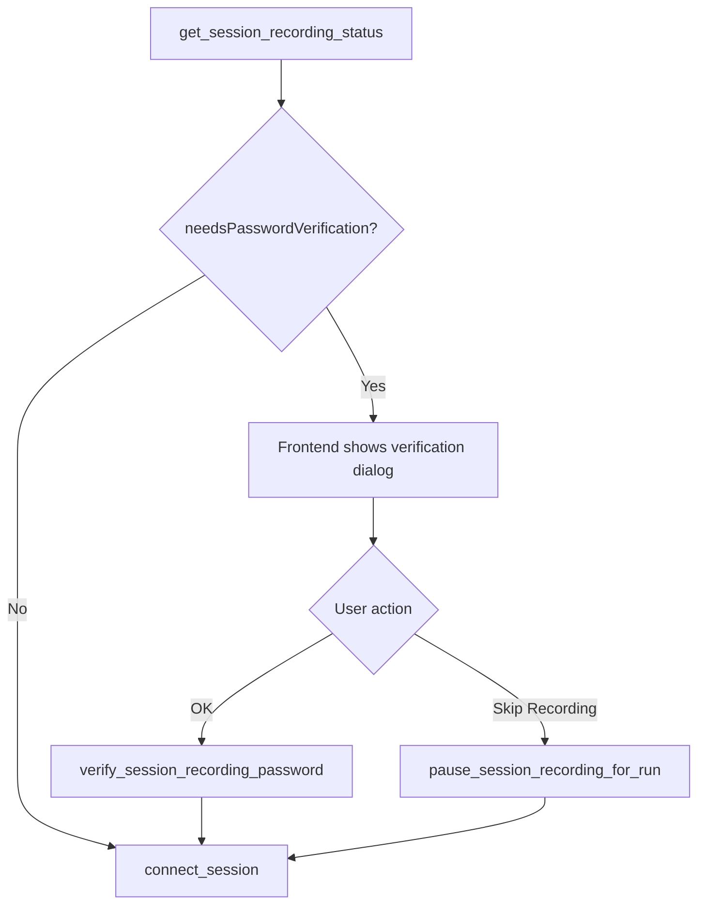

# Frontend / Backend Contracts

## Overview

The React frontend communicates with the Tauri backend through typed commands and runtime events exposed by `src\api\client.ts`.

## Connection commands

### `list_connections() -> ConnectionRecord[]`

Returns all saved connections. The `hasPassword` field comes from persisted non-secret metadata, so listing connections does not require a live keyring lookup.

### `create_connection(input) -> ConnectionRecord`

Creates a connection record and optionally stores a password in the keyring.

### `update_connection(input) -> ConnectionRecord`

Updates the connection record and synchronizes keyring password state.

### `delete_connection(id) -> void`

Deletes the connection record and removes any stored password for that connection identity.

## Settings commands

### `get_app_settings() -> AppSettings`

Returns persisted user preferences.

### `update_app_settings(settings) -> AppSettings`

Stores and returns the normalized settings payload.

### `get_session_recording_status() -> SessionRecordingStatus`

Returns the current runtime recording status:

- `configuredEnabled`
- `passwordConfigured`
- `passwordLoaded`
- `canRecord`
- `pausedForRun`
- `needsPasswordVerification`
- `logDirectory`
- `currentStorageBytes`

### `update_session_recording_settings(settings, password?) -> UpdateSessionRecordingSettingsResult`

Stores the session-recording settings, updates the runtime password when supplied, updates the persisted password verifier when a new password is supplied, and returns:

- `appSettings`
- `status`

`settings` also carries the optional custom `logDirectory` path that becomes the effective recording directory when non-empty. When recording is enabled and `password` is omitted, the backend keeps the existing verifier if one is already configured, so users can save other recording settings without re-entering and confirming a new password. Supplying a new password replaces the verifier and runtime password without requiring or verifying the old password. The command has no old-password or reset flag parameters. The settings UI uses one Change Password action, requiring a new password (minimum 8 characters) and matching confirmation, and shows an inline warning that existing logs retain their original passwords. Changing the password does not recover or re-encrypt existing logs, or replace the password held by already-active recorders; it applies to newly started recordings.

### `verify_session_recording_password(password) -> SessionRecordingStatus`

Validates the existing recording password for the current app run, loads it into runtime memory, clears any pause-for-run flag, and returns the updated status.

### `pause_session_recording_for_run() -> SessionRecordingStatus`

Implements the **Skip Recording** action: skips recording for all sessions in the current app run, clears the runtime password, stops active recorders if present, and returns the updated status. Persisted settings and the password verifier stay unchanged. The frontend closes the dialog and continues the pending connection without recording. Later connections in this run do not prompt again; restart requires verification again. Settings can explicitly clear this temporary state by verifying the existing password. The connection dialog has exactly **Skip Recording** and **OK**, with a themed, multiline tooltip on Skip Recording (shown on hover or keyboard focus, without duplicating the explanation in the dialog body), and no cancellation or reset action.

## Import / export commands

### `export_connections() -> ConnectionsExportPayload`

Returns the JSON-serializable backup payload for app settings plus all saved connections. In Tauri builds, the frontend uses this payload after the user chooses a destination in the native save dialog.

### `write_export_file(path, payload) -> void`

Writes the pretty-printed JSON backup payload to the user-selected path.

### `import_connections(payload) -> ImportConnectionsResult`

Merges the supplied backup payload into the local database and returns:

- `imported`
- `skipped`
- `settingsApplied`

## Session commands

### `connect_session(connectionId) -> SessionState`

Starts an SSH session for the selected connection. If recording is enabled but the current app run still needs password verification, the command returns a validation error and the frontend must resolve that recording gate first.

### `write_session_input(sessionId, data) -> void`

Writes terminal input to the target PTY session.

### `resize_session(sessionId, cols, rows) -> void`

Updates the PTY size to match the xterm viewport.

### `disconnect_session(sessionId) -> SessionState`

Stops the active SSH process for the session and returns the disconnected session state payload.

### `close_session(sessionId) -> void`

Removes the target session from the backend session list and releases backend resources.

### `get_session_states() -> SessionState[]`

Returns the currently tracked session snapshots on startup so the frontend can restore open tabs.

Each `SessionState` may also include:

- `recordingActive`
- `recordingMode?`

### `get_session_terminal_buffer(sessionId) -> string`

Returns the buffered PTY output for the requested session so the frontend can replay any early SSH text that appeared before the runtime event listener finished attaching. This is especially important for first-connection prompts such as host-authenticity confirmation and password entry.

## Connection history commands

### `get_connection_history_overview(range) -> ConnectionHistoryOverview`

Returns host-level connection-history summaries for the requested range:

- `last_7_days`
- `last_30_days`
- `last_90_days`
- `all_time`

Each host summary includes:

- `historyKey`
- `connectionId`
- `connectionName`
- `host`
- `port`
- `username`
- `deleted`
- `latestConnectionAt`
- `totalConnectionCount`
- `totalDurationSeconds`

### `get_connection_history_host_details(historyKey, range) -> ConnectionHistoryHostDetails`

Returns the selected host summary plus:

- `sessions`
- `durationBuckets`
- `summarizedSessionCount`
- `summarizedDurationSeconds`

`durationBuckets` uses these fixed bucket identifiers:

- `under_5_minutes`
- `between_5_and_30_minutes`
- `between_30_minutes_and_2_hours`
- `over_2_hours`

### `check_for_updates() -> UpdateCheckResult`

Queries GitHub from the backend for the latest release and returns:

- `currentVersion`
- `latestVersion`
- `updateAvailable`
- `downloadUrl?`

## Session log commands

### `list_session_logs() -> SessionLogList`

Returns discovered `.irlog` metadata from the configured recording directory so the `Logs` workspace can render left-side source navigation and right-side per-source file selection without opening a file picker first.

- `files: SessionLogFileInfo[]` contains readable metadata, sorted by creation time descending, then host, username, part, and filename.
- `warnings: SessionLogWarning[]` contains `{ fileName, path, error: AppError }` for each unreadable or invalid file, sorted by filename. The error includes `code`, `message`, and optional/nullable `details`. File header, metadata, and RFC 3339 creation timestamp failures affect only that file; even an all-invalid directory returns a successful result with warnings and no files.
- Discovery reads only direct entries with the exact lowercase `.irlog` extension and skips non-file entries. Listing reads plaintext metadata without a decryption password and does not validate encrypted payloads or modify existing files.
- Failure to initialize, open, or enumerate the directory rejects the command with `AppError` rather than returning an empty listing.

The frontend displays the loaded/failed counts with expandable filename/error details, handles structured errors through `normalizeError`, and reserves the empty-directory message for a successful result with neither files nor warnings. A failed refresh preserves the last successful listing and selection. A successful refresh reconciles selection with the new files. The refresh button is disabled while loading; tab changes ignore outstanding results and continue to clear decryption secrets.

### `preview_session_logs(paths, password) -> SessionLogPreview`

Decrypts one or more `.irlog` files and returns:

- `files`
- `previewText`
- `truncated`

### `export_session_logs(paths, password, outputPath) -> void`

Decrypts one or more `.irlog` files and writes the combined plain-text export to `outputPath`.

### `open_session_logs_directory() -> void`

Opens the configured session-log directory in the host OS file explorer.

## File transfer commands

### `transfer_file(input) -> FileTransferResult`

Runs an upload or download through the backend `russh`-based SFTP client.

- Upload accepts a local file or local directory.
- Download accepts a remote file or remote directory.
- File transfers may target either a directory path or a specific file path rename when the source is a file.
- Directory transfers require the destination side to be a directory.
- The desktop runtime should support both saved-password auth and non-interactive SSH-key auth for transfers.
- Transfers use an independent connection, not the browser's cached connection. Same-name files are replaced and directory contents are merged; the panel asks the user to confirm before invoking this command.
- Connection setup and SFTP requests time out after 15 seconds. File streaming has a 300-second read/write stall timeout and no fixed total duration limit.

### `list_remote_directory(connectionId, path?, browserId?, showHidden?) -> RemotePathListing`

Lists a single remote directory for the lazy-loaded file tree. Blank `path` resolves to the SFTP user's initial directory. `showHidden` defaults to false; `.` and `..` are always omitted. The response remains `{ currentPath, entries: [{ name, path, isDirectory }] }`, sorted directories first, then case-insensitively by name.

An optional `browserId` (the panel's terminal session ID) reuses a serialized browser connection with a 60-second idle lifetime. Without it, each call connects and closes independently. Saved connection changes invalidate the client; listing errors/timeouts discard it so the next attempt reconnects. A directory operation times out after 15 seconds, in addition to at most 15 seconds waiting for its browser lock. Saved-password and non-interactive SSH-key authentication remain supported independently of the terminal login.

### `open_remote_path(connectionId, browserId, path, showHidden?) -> RemotePathOpening`

Opens a directory or locates a regular file using the same pooled browser connection, authentication and timeouts as listing. The response is `{ listing: RemotePathListing, selectedEntry: RemotePathEntry }`. SFTP canonicalization and metadata determine the target type before listing. A directory returns its own listing/selection; a file returns its parent's listing and the canonical file entry. No file contents are opened or executed. The frontend resolves relative input against its committed browsing directory before calling this command; blank input resolves to the SFTP login directory.

`showHidden` defaults to false. An explicitly requested hidden file is included so the UI can select it without changing that preference; other hidden entries remain filtered. Missing paths, metadata/listing permission failures, disappearing files and unsupported special objects return errors. A failed directory listing is never retried as if it were a file. The frontend commits navigation only after success and ignores stale responses from earlier navigation/visibility settings.

### `close_remote_browser(browserId) -> ()`

Removes and closes a cached browser connection. Safe to call repeatedly or with an unknown ID. Called when a panel becomes hidden or unmounts; it does not cancel file transfers. Closing an in-flight browser waits for its lock, bounded by 15 seconds.

### `search_remote_files(input) -> RemoteSearchResult`

`input` contains `connectionId`, `path`, `mode` (`name` or `content`), `query`, and optional `showHidden` (default false). The nonempty query is a case-insensitive literal substring, limited to 1024 UTF-8 bytes. The UI sends a selected directory as the recursive scope; for a selected file it sends the parent directory for name search and the file itself for content search.

The response contains `matches`, `scannedEntries`, `skippedEntries` and `truncated`. Each match includes `name`, `path`, `isDirectory`, and nullable `line` (one-based) / `preview` (up to 240 characters). Content matches are reported per matching line. Search reads through an independent, read-only SFTP connection and does not execute shell commands or lock the browser connection.

Search is bounded to 30 seconds of scanning, 5,000 visible entries, 256 directories, depth 32, 100 matches, and 16 MiB of content reads. Connection setup and cleanup are separately bounded to 15 seconds each. Content search accepts UTF-8 text files up to 2 MiB each; binary, oversized or unreadable files are skipped and counted. Symbolic links may match by name but are never traversed/read. Unreadable subdirectories are skipped; an unreadable starting path returns an error. Reaching a time/traversal/result/byte limit returns available matches with `truncated: true`, so callers must not present the results as complete. Closing the inline search ignores late responses; an already-started backend scan finishes within these bounds.

## Runtime events

### `terminal-output`

Payload:

- `sessionId`
- `stream`
- `data`

### `session-status`

Payload:

- `sessionId`
- `connectionId`
- `connectionName`
- `status`
- `message?`

The backend emits this event both for terminal-output-driven transitions such as `connecting -> connected` and for direct SSH-process exit transitions such as `connected -> disconnected` after a remote shutdown.

### `session-removed`

Payload:

- `sessionId`

Used by the frontend to remove closed tabs and clean up buffered output.

## Frontend-only bridge helpers

`src\api\client.ts` also exposes a few frontend helpers around the raw Tauri commands:

- `saveExportConnections(payload)` opens the native save dialog in Tauri builds, then calls `write_export_file`.
- `pickTransferLocalPath(direction, selectionMode, currentLocalPath, currentRemotePath)` opens the native file or folder picker used by the file panel. The single Upload icon's menu selects `file` or `directory`; the frontend passes an upload destination of the selected remote directory or selected file's parent. Download chooses the picker mode from the selected remote item's type. The backend transfer input shape is unchanged.
- `checkForUpdates()` calls the Tauri `check_for_updates` command in desktop builds and falls back to a direct GitHub lookup only outside Tauri.
- `listSessionLogs()` loads discovered `.irlog` metadata for the in-window `Logs` workspace, where the frontend groups sources in the sidebar and renders the selected source's files in the right panel.
- `pickSessionLogFiles()` opens the native multi-file picker for `.irlog` files when a manual file-pick flow is still needed.
- `pickSessionLogDirectory()` opens the native directory picker for a custom recording directory.
- `exportSessionLogs()` opens the native save dialog for the exported `.txt` file before calling `export_session_logs`.

## Browser mock behavior

When the app is not running inside Tauri:

- connections are mocked in memory
- settings are persisted via browser storage
- sessions are simulated
- session recording settings, persisted verifier state, and runtime password / pause-for-run state are simulated in memory
- connection history is simulated in memory and finalized when mock sessions close
- import/export works against the mock store, including settings when present
- exports fall back to the browser download flow because the Tauri native save dialog is not available
- local transfer-path picks return mock file or folder paths
- remote browsing returns mock remote directory entries
- session-log listing returns `{ files, warnings: [] }` from the mock in-memory log store; preview and export use the same store

This keeps `npm run dev` useful for UI development without the Rust runtime.
