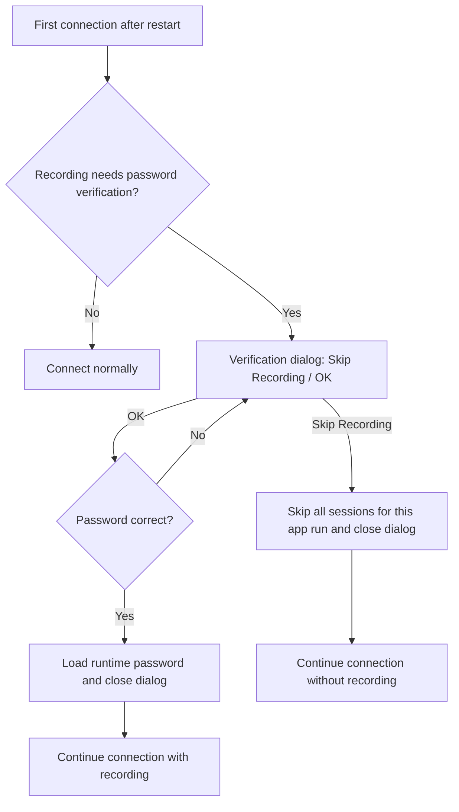
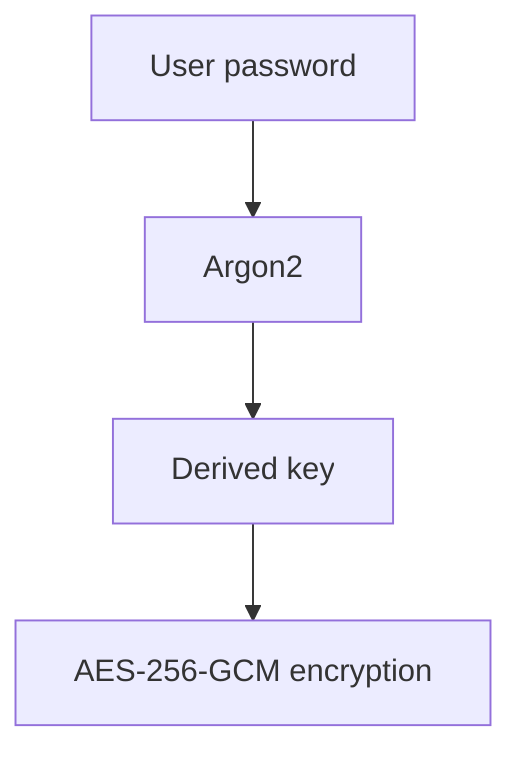
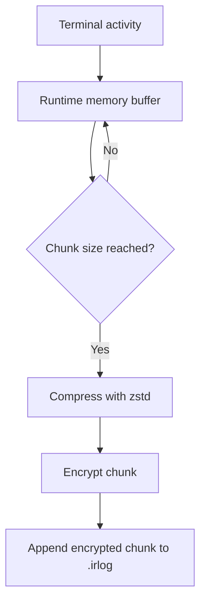

# Iridium Remote - Session Recording Requirements (V1)

## 1. Feature Overview

Implement an optional Session Recording feature for SSH sessions.

The purpose of this feature is to allow users to securely record terminal activity for:

* Auditing
* Troubleshooting
* Operational review
* Learning and replay

This feature is disabled by default.

---

# 2. Design Principles

* Security first
* Explicit user consent
* Local-only storage
* Minimal configuration complexity
* Stable long-running recording
* No plaintext logs on disk

---

# 3. Recording Rules

## 3.1 Recording Scope

Only content visible in the terminal UI may be recorded.

The system MUST NOT record:

* Password input
* Hidden characters
* Masked terminal input
* Non-visible terminal content

Examples:

* SSH password prompts
* sudo password input
* Any hidden terminal input mode

If characters are not displayed in the terminal window, they MUST NOT be recorded.

---

# 4. Recording Modes

The application supports the following recording modes:

## Disabled

No session recording.

---

## Input Only

Record only user-entered commands.

Examples:

```text id="vhtr7v"
ls
cd /var/log
docker ps
```

Terminal output is NOT recorded.

---

## Full Session Recording

Record:

* User input
* Terminal output

This mode may capture sensitive information displayed in the terminal.

The application MUST display a warning before enabling this mode.

Example warning:

```text id="ljjlwm"
Full session recording may capture sensitive information,
including secrets or confidential data displayed in terminal output.
```

---

# 5. Settings Menu

## Menu Structure

```text id="3yupae"
Settings
  └── Session Recording
```

In the Settings menu, `Session Recording` should appear after the existing Language and Theme items.

---

# 6. Session Recording Settings

## 6.1 Enable Recording

```text id="u4mnzl"
[ ] Enable Session Recording
```

Disabled by default.

When unchecked, all other controls in the Session Recording dialog should be disabled visually and functionally.
If recording is turned off while an SSH tab is already open, that tab must stop recording immediately and any visible recording indicator must disappear.

---

## 6.2 Recording Mode

```text id="6thqga"
( ) Input Only
( ) Full Session Recording
```

Default:

* Input Only

---

## 6.3 Encryption Password Management

Password management lives in **Settings -> Session Recording**, separately from the connection-time verification dialog.

* **First-time setup:** require Encryption Password and Confirm Password (minimum 8 characters).
* **Existing password:** show its runtime status and explicit actions instead of always showing replacement-password fields. Saving other settings must preserve the existing password and verifier.
* **Verify Password:** validate the existing password and load it into runtime memory without replacing the verifier. This also clears the skip-for-run state. Verification does not change unsaved settings or close the settings page.
* **Change Password:** the single password-replacement action on this settings page. Require New Password (minimum 8 characters) and Confirm Password, with no old-password field or validation. It also lets users who forgot their previous password continue recording with a new one. There is no separate Reset Password action or acknowledgement checkbox.
* Change Password MUST display an inline warning: new passwords apply to new recordings only; each existing log still requires the password used when it was recorded. Changing the password neither recovers nor re-encrypts existing logs, including logs whose password was forgotten.
* The backend accepts a new password without requiring the old password or a reset flag, even when an existing verifier is configured and the runtime password is not loaded.

The password encrypts session log files and MUST NOT be permanently stored. A separate password verifier may be persisted to validate it after restart. Password fields are cleared when switching actions or successfully verifying the existing password.

All dependent controls remain disabled while Enable Session Recording is unchecked.

---

## 6.4 Password Verification After Restart

If recording remains enabled after restart, no recording password is loaded in runtime memory. The first connection attempt MUST open **Verify Session Recording Password**.

The dialog:

* asks only for the existing password, with no confirmation-password field;
* has exactly two buttons: **Skip Recording** and **OK**;
* has no Cancel, Reset Password, close button, Escape dismissal, or backdrop dismissal;
* explains the skip scope only in a theme-aware, rounded, multiline tooltip on Skip Recording; do not repeat it in the dialog body;
* shows the tooltip after about 300ms of hover or immediately on keyboard focus, with Escape dismissing only the tooltip;
* supports Enter to submit verification;
* disables input and both actions while a request is pending to prevent duplicate submissions.

**OK** validates the password. Success loads it into runtime memory, closes the dialog, and continues the pending connection with recording enabled. Failure keeps the dialog open and allows another attempt or Skip Recording. Subsequent connections in the same app run do not require verification again once the password is loaded.

Suggested tooltip (two sentences on separate lines, with natural wrapping):

> Skip recording for all sessions in this app run.
>
> Verify your password again after restart.

---

## 6.5 Skip Recording for the Current App Run

**Skip Recording** closes the verification dialog and continues the pending connection without recording. It does not cancel the connection.

* All subsequent sessions in this app run also skip recording and do not show the verification dialog again.
* The runtime recording password is cleared; existing active recorders are stopped if present.
* The persisted enabled setting and password verifier remain unchanged.
* Restart clears the temporary skip state; if recording is still enabled, the first connection requires password verification again.
* Users can explicitly resume recording for new sessions through Verify Password in Settings -> Session Recording. Skipped activity is not recorded retroactively.
* Reset Password is not offered in the connection dialog. Users who forgot the password can skip recording, then open Settings -> Session Recording and use Change Password to set a new password for subsequent recordings.



---

# 7. Encryption Design

## 7.1 Encryption Algorithm

Use:

* AES-256-GCM

Reason:

* Modern authenticated encryption
* Integrity protection
* Industry-standard security

---

## 7.2 Key Derivation

The encryption password MUST NOT be used directly as an encryption key.

Use:

* Argon2

Flow:



---

# 8. Storage Policy

## 8.1 Max Log File Size

```text id="7bjlwm"
Max Log File Size
Default: 100 MB
```

When the size limit is reached:

* Automatically create a new rotated log file

Example:

```text id="ks4r0i"
2026-05-16_14-32-08_root_server01_part01.irlog
2026-05-16_14-32-08_root_server01_part02.irlog
```

---

## 8.2 Max Total Storage

```text id="4v6w74"
Max Total Storage
Default: 5 GB
```

When the storage limit is reached:

* Automatically delete oldest log files

(FIFO strategy)

---

## 8.3 Retention Period

```text id="j3u8tm"
Retention Period
Default: 30 days
```

Expired log files are automatically deleted.

---

## 8.4 Log Directory

```text id="uw6ltj"
Directory
Default:
%LOCALAPPDATA%\Iridium Remote\SessionLogs
```

Recommended actual path:

```text id="5lfjlwm"
C:\Users\<username>\AppData\Local\Iridium Remote\SessionLogs
```

The application SHOULD provide:

```text id="0d7d8g"
[ Open Folder ]
```

button for convenience.

Users should also be able to customize the log directory path from the Session Recording dialog.

---

## 8.5 Current Storage Usage

Display current storage usage.

Example:

```text id="wpxd0m"
2.1 GB used
```

---

# 9. Session Recording Lifecycle

## 9.1 Session Start

When:

* Session recording is enabled
* SSH session becomes active

The application starts collecting session data.

---

## 9.2 Recording Pipeline

To avoid excessive memory usage and plaintext disk writes:

The application uses chunk-based encrypted streaming.

Flow:



---

## 9.3 Chunk Size

Recommended default:

```text id="n08g0f"
1 MB
```

Each chunk is:

* Independently encrypted
* Written directly to disk after encryption

This design:

* Prevents excessive memory usage
* Avoids plaintext disk writes
* Improves crash recovery

---

# 10. Compression

Before encryption:

* Compress session data

Recommended:

* zstd
  or
* gzip

---

# 11. Log File Format

## Extension

```text id="fqjlwm"
.irlog
```

Example:

```text id="szhtp6"
2026-05-16_14-32-08_root_server01.irlog
```

---

## File Structure

```text id="fp5es7"
Header
Metadata
Encrypted Chunks
```

---

## Metadata (plaintext)

Example:

```json id="vqjlwm"
{
  "version": 1,
  "host": "192.168.1.10",
  "username": "root",
  "recording_mode": "input-only",
  "created_at": "2026-05-16T14:32:08Z"
}
```

Metadata MUST NOT contain:

* Passwords
* Encryption keys
* Sensitive secrets

---

# 12. Session Log Viewer

## Workspace Structure

```text id="4i08z5"
Sidebar Tabs
  ├── Connections
  ├── History
  └── Logs (only when session recording is enabled)
```

---

# 13. Open Session Logs

Users can:

* Open the `Logs` workspace
* Browse discovered log sources in the left sidebar
* Browse one or multiple `.irlog` files for the selected source in the right panel
* Enter encryption password
* Decrypt logs
* Export logs
* Leave and return while keeping the selected source/files but clearing the entered password and decrypted preview

---

# 14. Export Format

Supported export format:

```text id="8rzjlwm"
.txt
```

---

# 15. Recording Status Indicator

When recording is active, the UI SHOULD display:

```text id="zjlwm8"
● Recording
```

or:

```text id="qbpkmm"
● Input Recording
```

If recording stops for the active session because the feature was disabled, the indicator should be removed immediately.

This indicator helps ensure transparency and user awareness.

---

# 16. Security Requirements

The application MUST NOT:

* Store plaintext passwords
* Store encryption passwords permanently
* Record hidden terminal input
* Write unencrypted session logs to disk

---

# 17. Warning Message

The application SHOULD display:

```text id="2i8sjc"
Session recording may capture sensitive information.
Users are responsible for compliance and data protection.
```

---

# 18. Out of Scope (V1)

The following features are NOT included:

* Cloud sync
* Remote upload
* Real-time playback
* Search indexing
* Team audit system
* Shared logs
* Key file encryption support
* Online log streaming

---

# 19. Definition of Done

The feature is considered complete when:

* Users can enable or disable session recording
* Input-only recording works correctly
* Full session recording works correctly
* Hidden/password input is never recorded
* Logs are encrypted successfully
* Logs can be decrypted and exported
* Log rotation works correctly
* Old logs are cleaned automatically
* No plaintext logs remain on disk
* Large sessions remain stable without excessive memory usage
